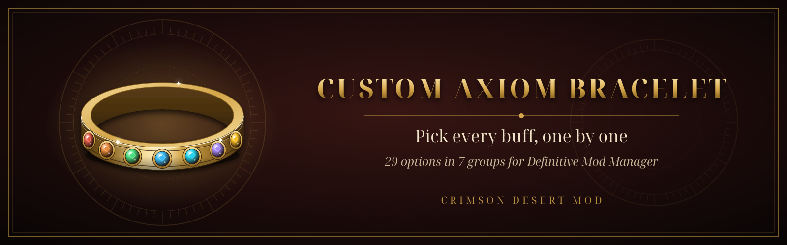

<p align="center">
  
</p>

<p align="center">
  <a href="https://github.com/Marukooh/Custom-Axiom-Bracelet/actions/workflows/build.yml"></a>
  <a href="https://github.com/Marukooh/Custom-Axiom-Bracelet/releases/latest"></a>
  <a href="https://www.nexusmods.com/crimsondesert/mods/4165"></a>
  
  
  
</p>

# Custom Axiom Bracelet

**Kliff, Oongka and Damiane all wear the Axiom Bracelet, and it does next to nothing.** This mod turns
it into the piece of gear you want: one download, **29 options** in **7 cards** in Definitive Mod Manager,
and every option is its own checkbox.

- **Pick buff by buff:** every option is independent, so any combination works.
- **Grouped and readable:** seven collapsible cards with plain names and a short description under each option.
- **All three characters:** each option applies to Kliff's, Oongka's and Damiane's Axiom Bracelet at once.
- **Charting the Unknown ready:** swim speed and breath buffs, at the highest level the game defines.
  The breath options need the DLC and are skipped automatically without it.
- **Quality of Life included:** bigger stacks, more charges, shorter cooldowns and tougher gear, each one optional.
- **Survives game updates:** DMM format 3 field-level edits find the right records by name, not by byte offset.

## What's inside

| Card | Options |
|---|---|
| 1 - Combat | Attack +999, Defense +999, Attack Speed, Critical Rate, Heal on Hit |
| 2 - Resistances | Fire, Ice, Lightning, Fall Damage Reduction |
| 3 - Regeneration | HP, Spirit, Stamina, Lower Stamina Use |
| 4 - Movement | Move, Climb, Swim Speed |
| 5 - Underwater (DLC) | Max Breath, Breath Regen, Breath on Hit |
| 6 - Utility | Thievery, Animal Friendship, Contribution EXP, Metal Magnet, Restriction Immunity |
| 7 - Quality of Life | Max Stack 999999, 99 Charges, Shorter Item Cooldowns, Durability 65535, Never Destroyed When Broken |

Every bracelet buff counts as one Abyss effect, like the Abyss Gear in your armor. Players report that
more than 18 Abyss effects in total can leave the game on an endless loading screen: untick a few if
that happens. Stats, the two passives and the Quality of Life card are not Abyss effects.

## Requirements
- Crimson Desert **2.04.08**.
- [Definitive Mod Manager](https://www.nexusmods.com/crimsondesert/mods/633) **4.8** or newer.
- Optional: the **Charting the Unknown** DLC for the Underwater card.
- **Linux / Steam Deck:** add `winmm=n,b` to your launch options, e.g.
  `WINEDLLOVERRIDES="winmm=n,b" %command%`.

## Installation
1. Use **Mod Manager Download** on Nexus, or press **Import** in DMM and pick the zip from the
   [latest release](https://github.com/Marukooh/Custom-Axiom-Bracelet/releases/latest).
2. Tick the options you want in each card, then press **Mount**.

To change your build, tick or untick options and Mount again. To uninstall, untick everything and Mount.

## Building from source
```bash
python3 build.py
```
Writes the seven pack folders and `release/Custom Axiom Bracelet v<VERSION>.zip`. Python 3 standard
library only. The mod version is the game version it is validated for (`2.04.08`, or `2.04.08b` for a
second release on the same game version), set in `VERSION` in `build.py`.

Releases go through the **Release** workflow (Actions → Release → Run workflow): it checks the version,
builds the zip, creates the `v<version>` GitHub release and, if asked, uploads the file to Nexus Mods.

## Also by me
[Custom Artifact Challenges Difficulty](https://www.nexusmods.com/crimsondesert/mods/3370): choose how
forgiving or demanding the Artifact Challenges are, with four presets (Cheat, Easy, Moderate, Hard)
for timers, counts and distance requirements, including Charting the Unknown.

[Withdraw Camp Funds](https://www.nexusmods.com/crimsondesert/mods/3946): adds a Withdraw Camp Funds
option to Carl's menu at the Greymane Camp that turns Camp Funds back into silver.

## Contributing
Bug reports, compatibility notes for new game versions and pull requests are welcome: see
[CONTRIBUTING.md](CONTRIBUTING.md).

## License
Source-available, **all rights reserved**: you may read the code and contribute through pull requests,
but not copy, modify, redistribute or reuse it. Players may use the official release builds
unmodified. See [LICENSE](LICENSE), [NOTICE.md](NOTICE.md) and [CONTRIBUTING.md](CONTRIBUTING.md).

*Crimson Desert is a trademark of Pearl Abyss. This is an unofficial fan-made mod, not affiliated with
or endorsed by Pearl Abyss.*
